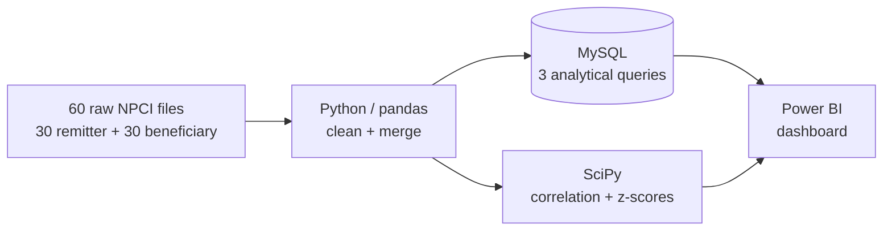

# 💸 UPI Failure Economics

**India's UPI loses ~2.4 billion payments to *technical* failures. Whose fault is it?**

Every failed UPI payment is someone standing at a shop counter, phone in hand, wondering if the money left their account. Some failures are the customer's doing (wrong PIN, low balance). Others are the bank's: servers down, timeouts, systems that couldn't keep up.

This project pulls apart those two kinds of failure using 30 months of public NPCI data, and names the banks that keep getting it wrong.

---

## The numbers at a glance

| | |
|---|---|
| **561 bn** | payments analysed (remitter side, top-50 banks each month, Jan 2024 – Jun 2026) |
| **2.36 bn** | payments lost to technical declines |
| **0.42%** | overall technical decline rate |
| **37 of 112** | banks breached 1% technical declines in 3+ months ("chronic violators") |
| **44%** | share of all technical failures caused by those 37 banks |
| **0.73% → 0.25%** | ecosystem technical decline rate, first 6 months vs last 6 months |


## What I found

1. **The system is getting much healthier.** Volume-weighted technical declines peaked at 1.07% in Feb 2024 and hit a low of 0.20% in Feb 2026.
2. **Failures are concentrated.** A third of banks cause 44% of the lost payments. Bank of India (129 Mn lost), Union Bank of India (116 Mn) and Central Bank of India (102 Mn) lead on total loss.
3. **Some banks fail month after month.** Central Bank of India and Indian Overseas Bank both breached the 1% line in 11 of 30 months. That's a structural problem, not bad luck.
4. **More traffic does not mean more failures.** Among the 10 busiest banks, 4 show a statistically significant relationship between volume and failure rate (p < 0.05), and all 4 are *negative*. The busiest banks tend to fail less. Part of this is the overall improvement over time, so it points to infrastructure quality, not load, as the driver.
5. **Sending is harder than receiving.** Debit-side (remitter) failures exceed credit-side (beneficiary) failures by 0.21 percentage points on average, and 279 bank-months differ by more than 0.4 points.
6. **95 bank-months were statistical outliers** (z-score > 2.5), useful for spotting outages that a monthly average would hide.

## How it works



1. **Clean** (`data_pipeline.ipynb`): the raw files have inconsistent formats (some store `0.89%`, others `0.0089`), a subtitle row above the header, and bank names spelled differently across months. The pipeline detects the format per file, standardises everything and outputs one 3,000-row table.
2. **Query** (`sql_queries_npci/`): three MySQL queries.
   - *Chronic violators:* banks above 1% technical declines in 3+ months, ranked by estimated lost transactions (`volume × TD%`).
   - *Month-over-month degradation:* `LAG()` window function to catch sudden jumps of 0.5 points or more.
   - *Remitter vs beneficiary asymmetry:* self-join comparing the same bank's sending and receiving failure rates.
3. **Test** (`diagnostics.ipynb`): Pearson correlation of volume vs failure rate for the top 10 banks, and per-bank z-score anomaly detection.
4. **Show** (`upi_ecosystem_audit.pbix`): Power BI dashboard tying it all together.

## Key terms

- **Technical decline (TD):** the payment failed because of a bank or network fault. The bank can fix this.
- **Business decline (BD):** the payment failed for a customer reason (insufficient funds, wrong PIN, limit exceeded).
- **Remitter bank:** the sender's bank (money leaves). **Beneficiary bank:** the receiver's bank (money arrives).
- **Lost transactions:** estimated as `total volume × technical decline %`.

## Repo structure

```
upi-failure-economics/
├── data/                      raw NPCI monthly files
│   └── processed/             cleaned + merged datasets
├── sql_queries_npci/          table setup + 3 analytical queries
├── sql_query_result_npci/     query outputs + diagnostics results (CSV)
├── data_pipeline.ipynb        cleaning and merging
├── diagnostics.ipynb          correlation + anomaly detection
├── upi_ecosystem_audit.pbix   Power BI dashboard
└── requirements.txt
```

## Run it yourself

```bash
git clone https://github.com/Aryan17289/upi-failure-economics.git
cd upi-failure-economics
pip install -r requirements.txt
jupyter notebook data_pipeline.ipynb    # builds data/processed/
jupyter notebook diagnostics.ipynb      # stats + anomalies
```

For the SQL part: run `npci_upi_database_&_table_setup.sql` in MySQL, import `data/processed/npci_upi_clean_data.csv` into `upi_bank_monthly_performance`, then run the three queries.

## Limitations

- NPCI publishes only the **top 50 banks** each month, so smaller banks appear in some months and not others.
- The **1% breach threshold** is my own choice for flagging chronic offenders, not an official NPCI rule.
- "Lost transactions" is an **estimate** based on monthly aggregates, not transaction-level data.
- Correlation is not causation. The volume-vs-failure result is a pointer, not proof.

## Tech

Python · pandas · SciPy · MySQL · Power BI · Jupyter

---

Built by **Aryan Chauhan** · [GitHub](https://github.com/Aryan17289)